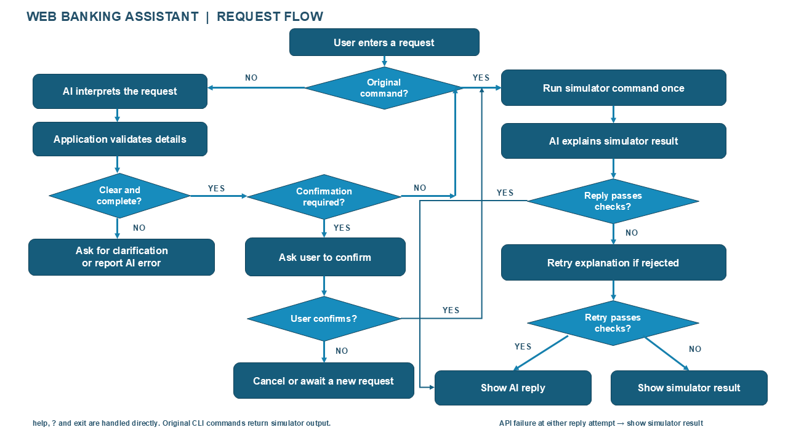
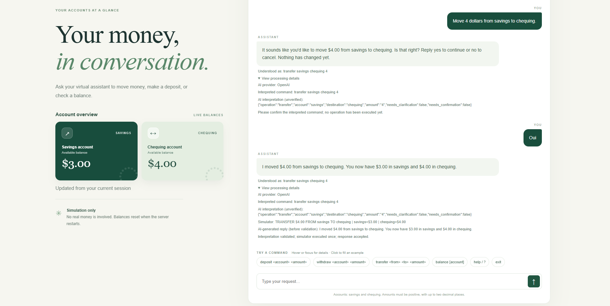
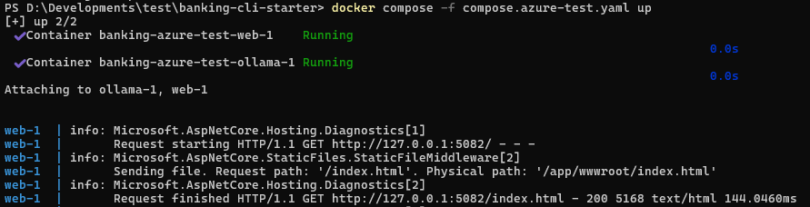

# Virtual Bank Assistant

[Screenshots](#screenshots) · [Run locally](#run-locally) · [Try it](#try-it) · [Checks](#checks) · [Project structure](#project-structure) · [Azure deployment](#azure-deployment)

A .NET 10 virtual banking assistant with a web interface for deposits, withdrawals, transfers, balance checks, and help. The `BankingCli` module simulates a banking system with predefined commands and banking rules.

The assistant routes original commands directly to the simulator. For natural-language requests, the selected model—local Gemma 3 through Ollama or OpenAI Luna—interprets the original message through an OpenAI-compatible API. `RequestInterpreter.cs` requests structured operation details, normalizes supported account aliases, validates the result, and builds a simulator command. Missing or unclear details prompt the user to try again. Interpreted transfers and other uncertain requests require confirmation before execution.

After the simulator executes a command, `ReplyWriter.cs` asks the selected model to explain the actual result in everyday English. Its prompt includes examples, and the application checks the generated reply against the simulator result. If the first reply fails validation, the application may request a corrected explanation. If generation fails or the corrected reply is rejected, the original result is shown without executing the transaction again. In the web interface, **View processing details** shows the selected provider, available interpretation and command, simulator result, generated reply, and processing outcome. Model outputs are not a view of the model's hidden reasoning.

Balances are simulated and stored in server memory for each session. They reset when the user ends the session with `exit` or the server restarts. The application uses two Docker containers: one for the .NET web application and simulator, and one for Ollama and the local Gemma model.

The following diagram summarizes request handling in the web interface. The original console application handles its commands directly, as noted in the diagram.



## Screenshots

**Local Gemma deposit.** The assistant interprets the request, asks for confirmation, and displays the simulator result and generated reply.


**OpenAI transfer with French confirmation.**

The user confirms with “Oui”; the assistant executes the transfer and displays the updated balances.



**Single-account and combined balance checks.**


**Insufficient funds and a request needing clarification.**

The simulator declines the withdrawal, and the incomplete transfer prompts for the missing account.


## Run locally

1. Install [Git](https://git-scm.com/install/) and Docker Desktop for [Windows](https://docs.docker.com/desktop/setup/install/windows-install/), [macOS](https://docs.docker.com/desktop/setup/install/mac-install/), or [Linux](https://docs.docker.com/desktop/setup/install/linux/). Start Docker Desktop with Linux containers and wait for the engine to be running.
2. Clone this branch and enter the project directory:

   ```sh
   git clone https://github.com/jandresengin/banking-cli-starter.git
   cd banking-cli-starter
   ```

   Example console output after cloning the repository and entering the project directory:

   

3. To use OpenAI, create a file named `.env` in the project directory with these two lines:

   ```dotenv
   DIRECT_OPENAI_API_KEY=your_openai_api_key
   DIRECT_OPENAI_MODEL=gpt-6-luna
   ```

   Replace the key with your own and use a model available to your OpenAI API account. API usage may incur charges. The `.env` file is ignored by Git; never share or commit it. **Gemma works without an OpenAI key**: skip this step if you only want the local model.

4. Build and start both containers:

   ```sh
   docker compose -f compose.azure-test.yaml up -d --build
   ```

   Building and downloading images can take several minutes depending on your internet connection and whether the images are already cached locally.

   

   On first launch, Ollama also downloads `gemma3:1b`; this may take several minutes. Check model readiness with:

   ```sh
   docker compose -f compose.azure-test.yaml logs -f ollama
   ```

   When the log says the model is available, open [http://127.0.0.1:5082/](http://127.0.0.1:5082/) or [http://localhost:5082](http://localhost:5082) and select **Gemma 3 · local** or **OpenAI**. If you change `.env` later, rerun the build and start command to recreate the web container.

5. To start the containers and follow their logs in the console, run:

   ```sh
   docker compose -f compose.azure-test.yaml up
   ```

   

   The console remains attached to the containers and displays their logs. Press `Ctrl+C` to stop them, or use a second terminal to stop and remove the containers and network:

   ```sh
   docker compose -f compose.azure-test.yaml down
   ```

   The local model volume is retained. Sessions and balances reset when the server restarts.

## Try it

The chat on the right accepts original commands and everyday requests interpreted by the selected model. The account cards on the left show the simulated savings and chequing balances for the current in-memory session.

Try these requests in English or French. Start with a deposit before making withdrawals or transfers. If asked to confirm, check the proposed operation and reply `yes` or `no`.

| Operation | Example request |
| --- | --- |
| Deposit | `Deposit 20 dollars into my savings account.` |
| Deposit | `Please put 15 dollars in my chequing account.` |
| Deposit | `Dépose 10 dollars dans mon compte d'épargne.` |
| Withdraw | `Take 2 dollars out of my chequing account.` |
| Withdraw | `Retire 2 dollars de mon compte d'épargne.` |
| Transfer | `Move 4 dollars from savings to chequing.` |
| Transfer | `Transfère 3 dollars du compte courant vers le compte d'épargne.` |
| Balance | `What is my chequing account balance?` |
| Balance | `What are my balances?` |
| Balance | `Quel est le solde de mon compte d'épargne ?` |

The models can interpret the same request differently. If details are unclear, the assistant may ask you to try again. Review the proposed command before confirming.

Original commands remain available: `deposit <account> <amount>`, `withdraw <account> <amount>`, `transfer <from> <to> <amount>`, `balance [account]`, `help`, `?`, and `exit`. Accounts are `savings` and `chequing`; amounts must be positive with at most two decimal places.

To run the original CLI in Docker, use `docker compose run --rm banking`. For natural-language requests in the CLI, set `OPENAI_API_KEY`, `OPENAI_MODEL`, and optionally `OPENAI_BASE_URL` in your environment or local `.env` file. The base URL defaults to `https://api.openai.com/v1` and must be an OpenAI-compatible API endpoint. These CLI variables are separate from the web selector's `DIRECT_OPENAI_*` settings above.

## Checks

Run the automated checks with `docker compose run --rm banking dotnet run --project Checks`. They use a simulated API. Observed checks:

1. Deposit $10 into savings and transfer $4 to chequing: balances were $6 and $4.
2. Ask to move $4 without accounts: the app requested clarification and balances stayed unchanged.
3. Simulate a reply API failure after a $1 transfer: the original simulator result was returned and the transfer ran once.

The following 20 English requests were also tested against the hosted application using separate simulated sessions for Gemma 3 and OpenAI Luna. Confirmation was given when requested. Results describe one observed run and may vary with model output.

| # | Conversational request | Gemma 3 local | OpenAI Luna |
|---|---|---|---|
| 1 | Could you deposit 20 dollars into my savings account? | Omitted amount; asked for clarification | Correct deposit |
| 2 | Please put 15 dollars in my chequing account. | Omitted amount; asked for clarification | Correct deposit |
| 3 | Add 7 dollars to savings, please. | Correct deposit after confirmation | Correct deposit |
| 4 | Can you put 8 dollars into checking? | Correct deposit after confirmation | Correct deposit |
| 5 | I would like to deposit 4 dollars into savings. | Correct deposit after confirmation | Correct deposit |
| 6 | Please withdraw 3 dollars from savings. | Correct withdrawal after confirmation | Correct withdrawal |
| 7 | Take 2 dollars out of my chequing account. | Correct withdrawal after confirmation | Correct withdrawal |
| 8 | Can I withdraw 5 dollars from savings? | Correct withdrawal after confirmation | Correct withdrawal |
| 9 | Please take 1 dollar from my checking account. | Correct withdrawal after confirmation | Correct withdrawal |
| 10 | Withdraw 999 dollars from savings, please. | Omitted amount; asked for clarification | Declined for insufficient funds |
| 11 | Move 4 dollars from savings to chequing. | Correct interpretation; declined for insufficient funds | Correct transfer |
| 12 | Please transfer 3 dollars from chequing to savings. | Correct transfer; response contained “Transfered” | Correct transfer |
| 13 | Can you move 2 dollars from savings into checking? | Correct transfer after confirmation | Correct transfer |
| 14 | Send 1 dollar from my chequing account to my savings account. | Correct transfer; original simulator result shown | Correct transfer |
| 15 | Transfer 5 dollars to savings. | Asked for missing source account | Asked for missing source account |
| 16 | What are my balances? | Correct balances after confirmation | Correct balances |
| 17 | How much money is in my savings account? | Correct balance; terse reply `Savings=$5.00` | Correct balance |
| 18 | What is my chequing account balance? | Correct balance; reply included `Reply:` | Correct balance |
| 19 | Can you show my checking balance? | Correct balance; reply included `Reply:` | Correct balance |
| 20 | How much do I have in both accounts? | Correct balances after confirmation | Correct balances |

In case 11, the Gemma session had less money because earlier deposits were not executed. English, French, and Spanish requests were also exercised. Luna handled all 20 English requests in this run, while Gemma needed clarification or produced less conversational replies in some cases. These observations do not establish performance across all inputs or languages.

## Project structure

### BankingCli — simulator and assistant

This folder contains the banking logic shared by the console application and the web app.

| File | Responsibility |
| --- | --- |
| [Program.cs](BankingCli/Program.cs) | Starts the console application. |
| [BankingApplication.cs](BankingCli/BankingApplication.cs) | Runs the console loop, routes input, and displays results. |
| [BankSession.cs](BankingCli/BankSession.cs) | Implements the simulator, in-memory balances, banking operations, and transaction rules. |
| [CommandRouter.cs](BankingCli/CommandRouter.cs) | Distinguishes original simulator commands from natural-language requests. |
| [BankingAssistant.cs](BankingCli/BankingAssistant.cs) | Coordinates interpretation, clarification, confirmation, command execution, and result explanation. |
| [RequestInterpreter.cs](BankingCli/RequestInterpreter.cs) | Requests structured details from the model, normalizes supported aliases, validates the interpretation, and builds a command. |
| [OpenAiClient.cs](BankingCli/OpenAiClient.cs) | Sends HTTP requests to the configured OpenAI-compatible API. |
| [ReplyWriter.cs](BankingCli/ReplyWriter.cs) | Requests and validates a conversational explanation, retries rejected replies, and describes commands for confirmation. |
| [BankingCli.csproj](BankingCli/BankingCli.csproj) | Configures the .NET console project. |

### BankingWeb — interface and server

| File | Responsibility |
| --- | --- |
| [Program.cs](BankingWeb/Program.cs) | Hosts the web API, manages in-memory sessions, routes requests, and configures the allowed origin and session cookie. |
| [index.html](BankingWeb/wwwroot/index.html) | Defines the account overview, conversation, provider selector, and controls. |
| [styles.css](BankingWeb/wwwroot/styles.css) | Styles the interface and responsive layout. |
| [app.js](BankingWeb/wwwroot/app.js) | Sends browser requests and updates the conversation, balances, and processing details. |
| [BankingWeb.csproj](BankingWeb/BankingWeb.csproj) | Configures the .NET 10 web project and includes the shared banking code. |

Session balances are stored in server memory and are lost when the session ends or the server restarts.

### Checks — verification

| File | Responsibility |
| --- | --- |
| [Program.cs](Checks/Program.cs) | Runs automated simulator and assistant checks using a simulated API. |
| [gemma_language_probe.py](Checks/gemma_language_probe.py) | Sends sample English, French, and mixed-language requests to a running local Gemma instance through the web app. |
| [Checks.csproj](Checks/Checks.csproj) | Configures the executable checks project and its shared code. |

The automated checks use simulated API responses. The language probe requires a running local model.

### Deploy — deployment support

| File | Responsibility |
| --- | --- |
| [ollama/Dockerfile](deploy/ollama/Dockerfile) | Builds the Ollama image used by the Azure-style configuration. |
| [ollama/start.sh](deploy/ollama/start.sh) | Starts Ollama and downloads the configured model if it is unavailable. |
| [AZURE.md](deploy/AZURE.md) | Documents the Azure Container Apps configuration. |

### Root files

| File | Responsibility |
| --- | --- |
| [BankingCli.sln](BankingCli.sln) | Defines the .NET solution containing the console project. |
| [Dockerfile](Dockerfile) | Provides a .NET SDK image for development with mounted source files. |
| [Dockerfile.runtime](Dockerfile.runtime) | Builds and publishes the web app, then runs it in a smaller ASP.NET runtime image. |
| [compose.yaml](compose.yaml) | Defines the development containers for the console and web app. |
| [compose.local.yaml](compose.local.yaml) | Adds local Ollama configuration to the base Compose setup. |
| [compose.optimized.yaml](compose.optimized.yaml) | Defines an optimized local web app and Ollama setup. |
| [compose.model-setup.yaml](compose.model-setup.yaml) | Temporarily provides network access for downloading the model in the optimized setup. |
| [compose.azure-test.yaml](compose.azure-test.yaml) | Approximates Azure's shared localhost networking and serves the local web app on port 5082. |
| [README.md](README.md) | Describes setup, behavior, examples, checks, and deployment. |
| [LICENSE](LICENSE) | Contains the repository license. |

## Azure deployment

The Docker images are built locally and pushed to Azure Container Registry (ACR). Azure Container Apps runs the .NET web application and Ollama as two containers in the same replica. The environment is configured to keep at least one replica available. The web application is exposed over HTTPS, while Ollama is reached by the web application over localhost.

The OpenAI API key is stored as a Container Apps secret and referenced by the web container. The model names and service endpoints are configured as environment variables. The deployed app follows the local two-container design; local Docker volumes and Azure's temporary container storage have different persistence behavior. See [Azure deployment notes](deploy/AZURE.md) for configuration details.
